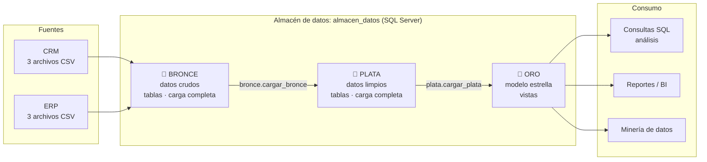
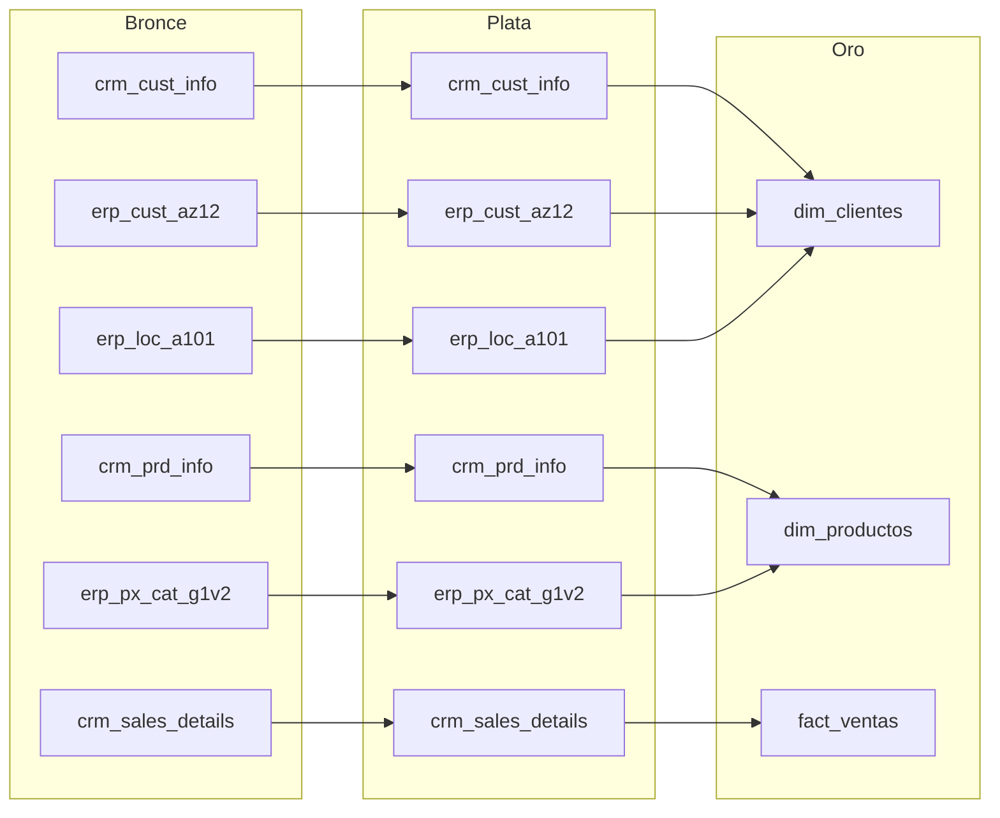
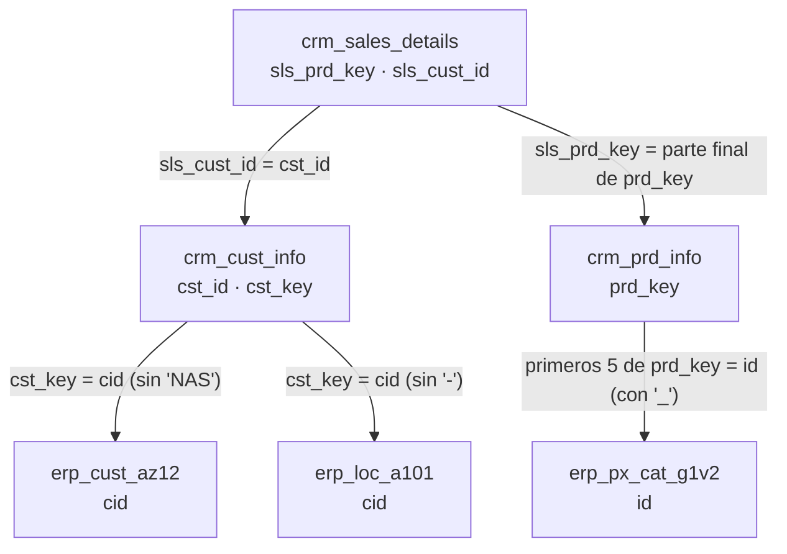
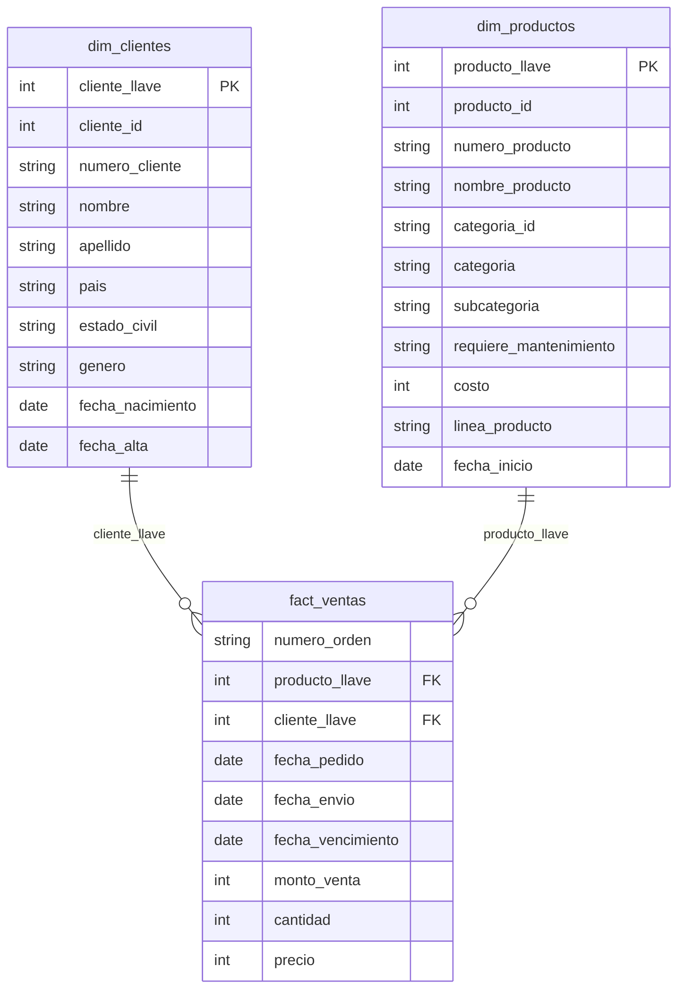

# 🗺️ Diagramas del proyecto

Los diagramas están escritos en **Mermaid**, así que GitHub los dibuja solos al abrir este archivo.
En Antigravity puedes verlos con una extensión de vista previa de Mermaid.

La idea es que también los dibujes tú en **Draw.io** (como en el video) y guardes los
`.drawio` en la carpeta `diagramas/`; dibujarlos es buena forma de entender el proyecto.

---

## 1. Arquitectura general

---

## 2. Flujo de datos (linaje): de qué tabla sale cada cosa

---

## 3. Cómo se relacionan las tablas de las dos fuentes

Esto es lo que hay que descubrir antes de limpiar: qué columna de un sistema "apunta" a cuál del otro.

---

## 4. Modelo estrella (capa oro)

